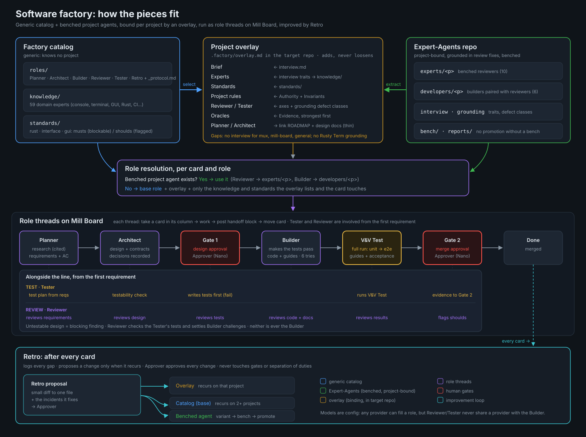

# Factory

A software factory: base roles, generic knowledge and house standards, bound to each project by an overlay and run as one Claude Code thread per role on Mill Board.



## Layout

```
roles/       Planner, Architect, Builder, Reviewer, Tester, Retro + _protocol.md (flow, gates, handoff)
knowledge/   59 generic domain experts; know no project
standards/   rust, interface, gui: musts (Reviewer can block) and shoulds (flagged)
overlays/    _template.md and drafts; the live copy goes in each target repo at .factory/overlay.md
threads/     one kickoff prompt per role thread + the shared loop
lenses/      lens.json + one plain prompt per board lens (architect, research, adversary, operator); read verbatim by rusty_orch, so no frontmatter or title
docs/        factory-map.svg
tools/       catalog check
```

## How it fits together

- **Roles** do the work. Main line: Planner → Architect → Gate 1 → Builder → V&V Test → Gate 2 → Done → Retro. The Tester and Reviewer are involved from the first requirement.
- **The Approver** (Nano) holds the two gates: design approval and merge approval.
- **Knowledge and standards** know no project. **Overlays** bind a project: which knowledge and standards, project rules, per-role notes, oracles. They add and tighten, never loosen.
- **Benched project agents** in [Expert-Agents](https://github.com/baileyrd/expert-agents) take precedence: the Reviewer uses `experts/<project>` and the Builder uses `developers/<project>` where they exist.
- Which model fills a role is configuration. Reviewer and Tester never share a provider with the Builder.

## Running it

See [threads/README.md](threads/README.md): open one Claude Code session per role and paste its prompt.

## Changing it

Retro proposes; the Approver approves. Overlay changes need the gap to recur on that project; base changes (roles, knowledge, standards) need it on two projects. Gates and separation of duties are never in scope. Changes to benched agents go through the Expert-Agents bench.

## Checks

```
python3 -m unittest
python3 -m tools.check
```

Python 3.11+, standard library only.
